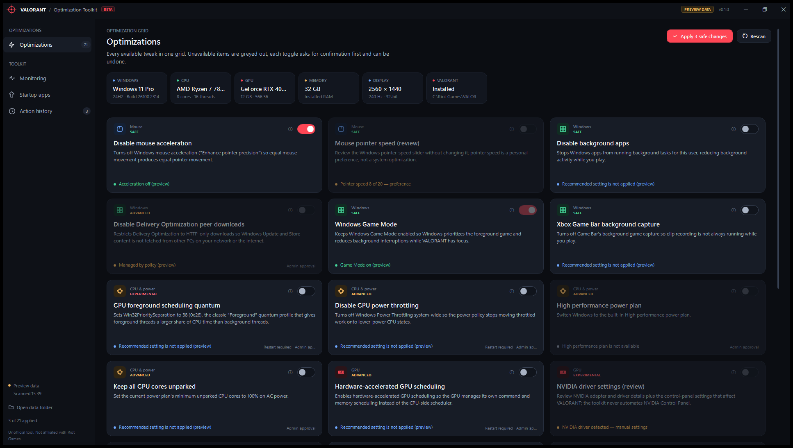
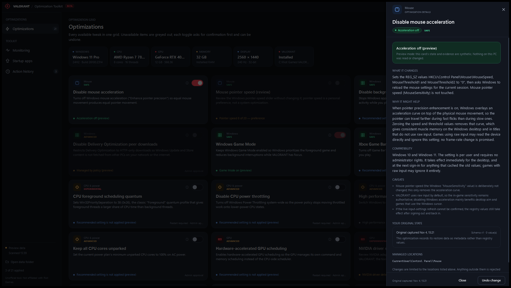
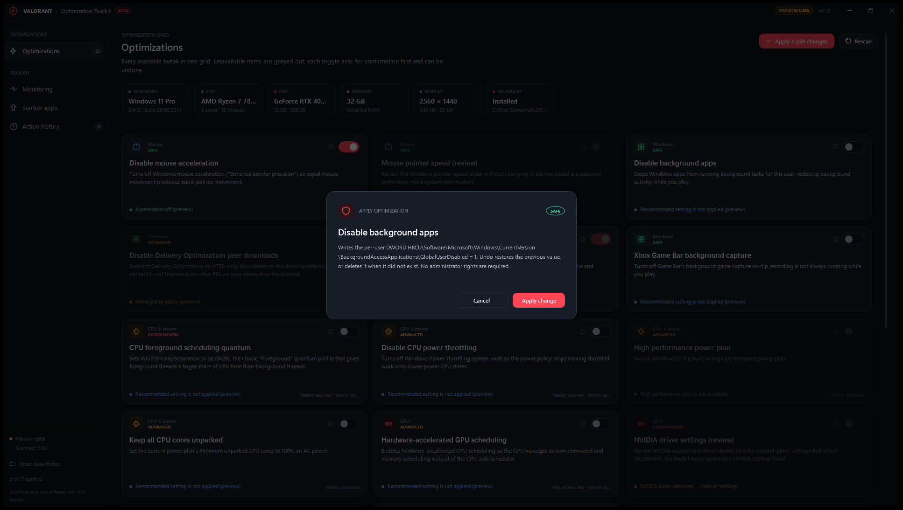
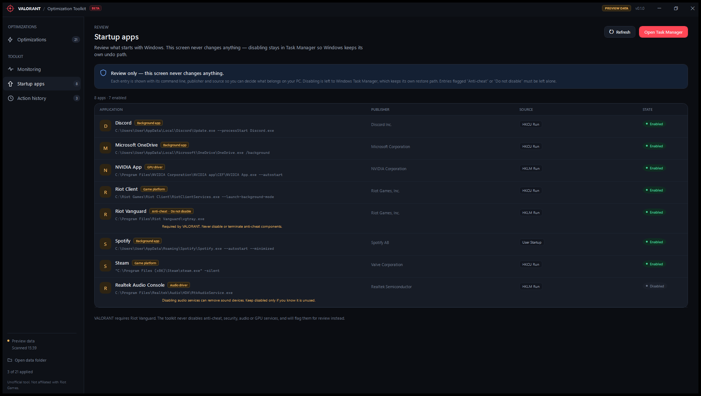
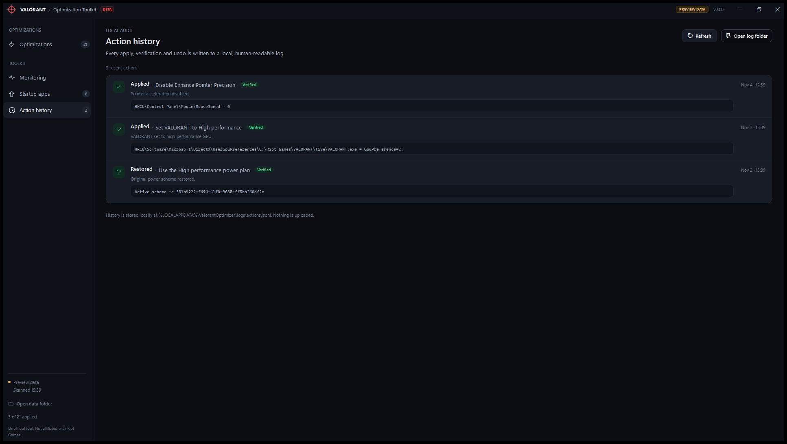
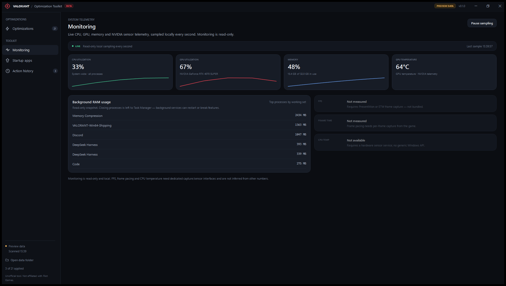

# VALORANT PC Optimization Toolkit

A Windows desktop app that scans your PC, explains specific gaming-related Windows settings, and lets you apply, verify and undo each change. Built with C#/.NET 10 and WPF.

It is deliberately **not** a script collection or a one-click "FPS booster". Every toggle is a managed change with a captured backup, a verification step and a one-click rollback; review-only cards inspect the machine and never write.

> Unofficial tool. Not affiliated with, endorsed by, or sponsored by Riot Games. VALORANT and Riot Games are trademarks of Riot Games, Inc.



*Screenshots use the built-in preview dataset; live monitoring metrics are synthetic there.*

## What it does

### System scan
Reads Windows edition/build, CPU, GPU and driver version, installed RAM, primary display mode/refresh rate, elevation state, and the installed VALORANT client path — without administrator rights. The summary strip shows what the toolkit found; every card shows its own evidence.

### Unified optimization grid
The sidebar has a single **Optimizations** entry — no Mouse/Windows/GPU category pages and no extra state-filter chips. All cards live in one uniform three-column grid, grouped visually by their category label. Each card shows a category icon, risk label, current state, short explanation and a toggle switch. Turning a toggle on opens the apply confirmation; turning a managed toggle off restores the captured backup. Unavailable cards (unsupported, policy-managed, or review-only) are greyed out and their toggle is disabled with an explanatory tooltip. The details drawer adds:

- exactly what is written (registry paths and values),
- why it might help (mechanism, no promised FPS numbers),
- compatibility notes and caveats,
- the captured original values,
- the registry scopes the module is allowed to touch.

### Optimization catalog

| Category | Card | Mode | Risk | Admin |
|---|---|---|---|---|
| Mouse | Disable mouse acceleration (`mouse-acceleration`) | Toggle | Safe | No |
| Mouse | Pointer speed review (`mouse-pointer-speed`) | Review only | Safe | No |
| Windows | Windows Game Mode (`windows-game-mode`) | Toggle | Safe | No |
| Windows | Xbox Game Bar background capture (`game-bar-capture`) | Toggle | Safe | No |
| Windows | Disable background apps (`windows-background-apps`) | Toggle | Safe | No |
| Windows | Delivery Optimization peer downloads (`delivery-optimization-peer`) | Toggle | Advanced | Yes |
| CPU & power | Disable CPU power throttling (`cpu-power-throttling`) | Toggle | Advanced | Yes |
| CPU & power | Keep all CPU cores unparked (`cpu-core-parking`) | Toggle | Advanced | Yes |
| CPU & power | CPU foreground scheduling quantum (`cpu-scheduling`) | Toggle | Experimental | Yes |
| CPU & power | High performance power plan (`power-plan-high-performance`) | Toggle | Advanced | Yes |
| GPU | Hardware-accelerated GPU scheduling (`gpu-hags`) | Toggle | Advanced | Yes |
| GPU | NVIDIA driver settings review (`nvidia-settings`) | Review only | Experimental | No |
| Memory | Memory overview (`memory-overview`) | Review only | Safe | No |
| Network | Keep network adapters powered on (`network-adapter-power`) | Toggle | Advanced | Yes |
| Network | Network / DNS overview (`network-overview`) | Review only | Safe | No |
| USB | Disable USB selective suspend (`usb-selective-suspend`) | Toggle | Advanced | Yes |
| USB | USB device power review (`usb-device-power`) | Review only | Safe | No |
| Storage | Storage overview (`storage-overview`) | Review only | Safe | No |
| VALORANT | VALORANT high-performance GPU preference (`valorant-gpu-preference`) | Toggle | Safe | No |
| VALORANT | VALORANT fullscreen-optimization compatibility flag (`valorant-appcompat`) | Toggle | Safe | No |
| VALORANT | VALORANT configuration review (`valorant-config`) | Review only | Safe | No |

Game Mode's missing registry value is treated as Windows' default *on*, not as "disabled". Delivery Optimization is reported as policy-managed and left alone when a Group Policy value exists. The High performance power plan and core-parking settings are reported **Unsupported** when the active plan does not expose them; the toolkit never creates or modifies power schemes. Review-only cards show their evidence but never write.

### Live monitoring
A separate **Monitoring** page samples CPU utilization, RAM usage, NVIDIA GPU utilization/temperature and the top processes by working set every second. Everything is read-only and stays local. FPS, frame times and CPU temperature are explicitly marked *not measured* because they require a game-capture hook or a hardware sensor service — the app does not guess them.

### Apply safe recommendations
When safe, non-elevated recommendations are available, one button applies them in sequence — each still captured, verified and individually undoable.

### Startup apps review
A read-only table of Run keys, Startup-approved entries and Startup-folder items, with publisher, command line, source, enabled state and risk flags (anti-cheat, GPU, audio, background apps). Nothing is disabled here; Windows Task Manager remains the owner of that state so there is always a native undo path.

### Local action history
Every apply, verification and undo is written to a human-readable JSONL file. The History page shows the newest results, changed values, timestamps, and links to the log folder. Nothing is uploaded or sent anywhere.

## Safety model

- **Backup before write.** The engine captures the exact original values (including "value did not exist") and persists a schema-versioned JSON backup before applying anything.
- **Verify after write.** Apply is followed by a fresh assessment; the result is only `Verified` when the expected state is observed. A verified apply is logged as `verified`, otherwise `applied-unverified` with a warning.
- **Automatic rollback.** If an in-process module throws or reports failure, the engine restores the captured values and verifies the restore. The elevated helper performs the same rollback inside one UAC session.
- **Scope validation.** Undo data is rejected unless every entry belongs to the module's declared `ManagedScopes`. The helper re-validates the request before writing.
- **On-demand elevation only.** The UI runs as the signed-in user. Privileged changes launch the separate `ValorantOptimizer.Elevated.exe` helper with a single request, and the helper exits afterwards. The main window never runs permanently as administrator.
- **No security or anti-cheat changes.** The toolkit never disables Defender, the firewall, Windows Update, Secure Boot, Riot Vanguard or other anti-cheat components, and never terminates anti-cheat processes.
- **No magic numbers.** No kernel drivers, undocumented timer hacks, blind service debloating, or generic "latency fixes". No FPS number is promised without controlled measurement on that machine.
- **Local-only.** No telemetry, network calls or cloud account. Logs and backups stay in `%LOCALAPPDATA%\ValorantOptimizer`.

See [docs/SAFETY.md](docs/SAFETY.md) for the guarantees and their implementation.

## Screenshots

| | |
|---|---|
|  |  |
|  |  |
|  |  |

## Requirements

- Windows 10 or 11, x64.
- To build: [.NET 10 SDK](https://dotnet.microsoft.com/download) (the repo targets `net10.0-windows`).
- To run a framework-dependent build: .NET 10 Desktop Runtime.
- The self-contained release build needs no installed runtime.

## Build, run and test

```powershell
cd ValorantOptimizer

dotnet build ValorantOptimizer.sln
dotnet test ValorantOptimizer.sln

# Normal live run (read-only until you press Apply)
dotnet run --project src\ValorantOptimizer.App

# UI preview with synthetic data and no system access
dotnet run --project src\ValorantOptimizer.App -- --demo

# Headless read-only scan + assessment, writes a JSON summary and exits
dotnet run --project src\ValorantOptimizer.App -- --smoke artifacts\scan-smoke.json
```

The first launch only reads state. No change happens until you explicitly confirm an Apply action.

## Publish

```powershell
powershell -ExecutionPolicy Bypass -File tools\build.ps1 -CreateZip
```

This builds, tests, publishes the app and the elevated helper as self-contained single-file executables, copies documentation, writes `SHA256SUMS.txt`, and optionally creates a zip in `artifacts/`.

```
dist/
  ValorantOptimizer.exe              app (unelevated)
  helper/
    ValorantOptimizer.Elevated.exe   one-shot elevated helper
  README.md
  docs/
  SHA256SUMS.txt
```

For a smaller, framework-dependent build:

```powershell
powershell -ExecutionPolicy Bypass -File tools\build.ps1 -FrameworkDependent
```

Release binaries are currently **unsigned**. SmartScreen may warn on first launch; verify the SHA-256 checksums before running. Code signing and a public checksum release process are planned.

## Where data lives

| Path | Contents |
|---|---|
| `%LOCALAPPDATA%\ValorantOptimizer\backups\<id>.backup.json` | Per-optimization original state, schema version, timestamp |
| `%LOCALAPPDATA%\ValorantOptimizer\logs\actions.jsonl` | Apply/verify/undo history |
| `%LOCALAPPDATA%\ValorantOptimizer\logs\elevated.log` | Elevated helper activity |
| `%LOCALAPPDATA%\ValorantOptimizer\logs\ui-crash.log` | UI crash details |
| `%LOCALAPPDATA%\ValorantOptimizer\elevation\` | Temporary request/response files, deleted after use |

The sidebar's **Open data folder** button opens the root. Backups and logs are plain JSON/JSONL and can be inspected or deleted while the app is closed. Deleting a backup removes the ability to Undo that card.

## Architecture

| Project | Responsibility |
|---|---|
| `ValorantOptimizer.Core` | Contracts, registry abstraction, schema-versioned backup store, JSONL action log, optimization engine, elevation protocol |
| `ValorantOptimizer.Diagnostics` | Read-only system snapshot, VALORANT locator (with scan cache), startup-app scanner, live CPU/RAM/NVIDIA metrics |
| `ValorantOptimizer.Optimizations` | 21 toggle/review modules across 9 categories and the explicit catalog |
| `ValorantOptimizer.App` | WPF shell, grid UI, view models, elevation client, composition root |
| `ValorantOptimizer.Elevated` | One-shot administrator helper with its own manifest |
| `tests/*` | Core, Diagnostics and Optimizations unit tests using fakes only |

Lifecycle: **assess → capture → apply → verify → (undo) restore → verify**. See [docs/ENGINE-CONTRACT.md](docs/ENGINE-CONTRACT.md) for the full module contract and the rules for adding an optimization.

### Add an optimization

1. Implement `IOptimization` in `src/ValorantOptimizer.Optimizations/<Category>/`.
2. Use `RegistrySnapshot.CaptureMany` / `RestoreAll`; never hand-roll capture or restore.
3. Declare every writable registry location in `ManagedScopes`, set `RequiresElevation` for HKLM/powercfg changes, and describe the change honestly.
4. Add tests with `FakeRegistryStore`/`FakeProcessRunner` covering apply, undo, and originally-absent values.
5. Register it in `OptimizationCatalog.CreateDefault` — one line.

`OptimizationCatalogValidator` runs at engine startup and rejects duplicate/invalid ids.

## Limitations and accuracy notes

- **Monitoring is deliberately partial.** FPS, frame times and CPU temperature are shown as unavailable instead of being inferred: they need PresentMon/ETW capture or a hardware sensor service that is not bundled. GPU telemetry is NVIDIA-only (`nvidia-smi`); AMD/Intel GPU utilization and temperature show N/A.
- **Review-only cards never write.** Pointer speed, NVIDIA control settings, memory overview/background RAM, network/DNS, USB device power, storage health/temp files and in-game VALORANT settings are inspection surfaces, not automated tweaks. Storage overview reports capacity and a bounded temp-size estimate (no SMART or live disk-activity counters); network overview reports adapters/DNS (no bandwidth or latency test).
- **No NVIDIA Control Panel automation.** G-SYNC, power management and texture filtering are driver/preference-dependent; the `nvidia-settings` card detects the driver and explains that this toolkit will not automate them.
- **Hardware-accelerated GPU scheduling** requires a reboot and driver support; it is reported Unsupported on builds older than 19041.
- **CPU core parking, CPU throttling and scheduling** are advanced/experimental, hardware-and-workload dependent changes. They may increase power use and heat, and the scheduling quantum is a documented-but-disputed setting. No FPS gain is promised.
- **Network adapter targeting is heuristic.** Physical Ethernet/Wi-Fi adapters are selected by driver metadata; virtual/VPN/WAN Miniport/Hyper-V/TAP adapters are skipped, and evidence lists each targeted adapter. Some drivers need the adapter re-enabled or a reboot.
- **In-game VALORANT settings** (raw input buffer, graphics options) are not edited; the VALORANT config card only reports what it finds.
- **High performance plan may be missing.** Windows 11 Home often hides it. The card reports Unsupported; it does not create a scheme.
- **Mouse acceleration can be bypassed** by games using raw input (VALORANT does). The change remains relevant to Windows pointer behavior; pointer speed (`MouseSensitivity`) is review-only and never changed automatically.
- **Game Mode defaults on.** Missing registry state is reported as the Windows default rather than "disabled".
- **Delivery Optimization** affects Windows Update/Store peer downloads, not in-game networking. Policy-managed PCs are review-only.
- **Startup review is read-only** by design. It identifies risky entries instead of disabling them.
- **No restore point creation.** The toolkit relies on exact per-setting backups. It does not perform large system changes that would warrant a restore point.
- **No FPS claims.** Cards explain mechanisms; performance depends on hardware, drivers and the game version.
- Windows builds differ; every card shows the evidence it found so unsupported/unknown states are visible.

## Verification

The repository has **437 unit tests** (Core 59, Diagnostics 103, Optimizations 275), all using fakes — no test modifies the real machine. The WPF UI was exercised end-to-end against the preview dataset (unified grid and greyed cards, toggles, confirmation, apply, bulk safe apply, undo, startup review, history, live monitoring) and the live app was smoke-tested read-only. Details: [docs/VERIFICATION.md](docs/VERIFICATION.md).

## Trademark and privacy

VALORANT and Riot Games are trademarks of Riot Games, Inc. This project is independent and not affiliated with or endorsed by Riot Games. The toolkit does not collect or transmit any data; all state stays on the local PC.
